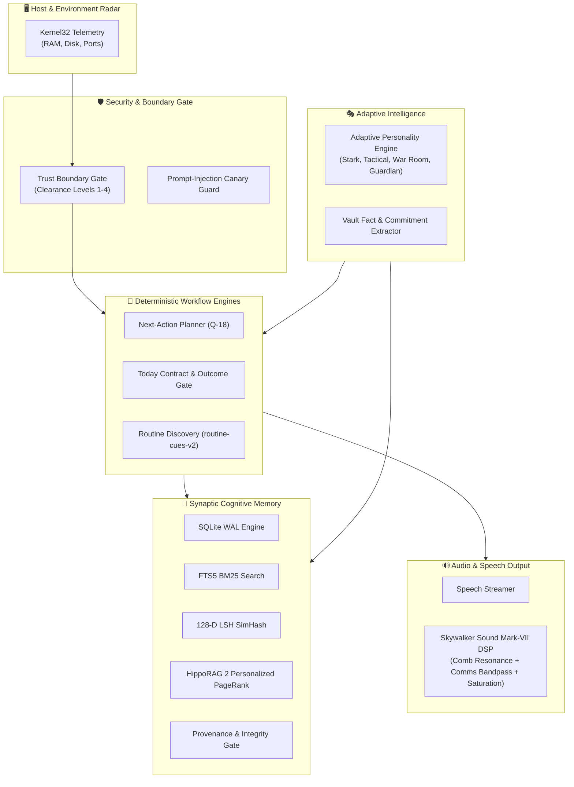
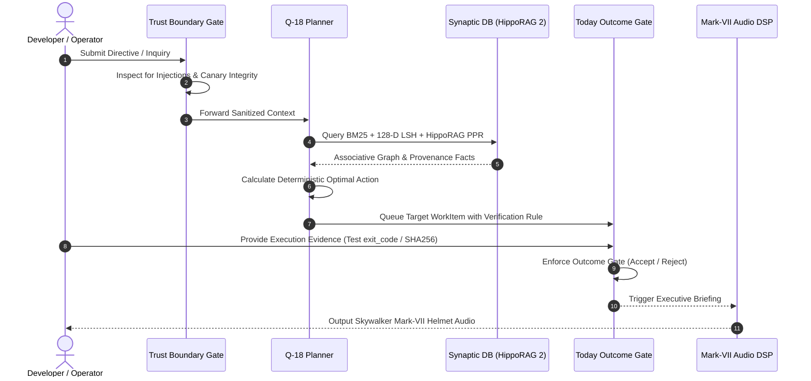

# J.A.R.V.I.S. Cortex OS

<p align="center">
  <strong>Autonomous Zero-Ollama Cognitive & Workflow Operating Brain</strong><br>
  <em>Cérebro Cognitivo e Operacional Autónomo Zero-Ollama</em>
</p>

<p align="center">
  
  
  
  
  
</p>

---

## 🌟 Overview / Visão Geral

### 🇬🇧 English
**J.A.R.V.I.S. Cortex OS** is a lightweight, zero-dependency autonomous cognitive architecture designed to serve as a resident operating intelligence on modern workstations. Engineered without bloated local LLM runtimes (zero Ollama required), it combines **biological associative memory** (HippoRAG 2 Personalized PageRank + 128-D Locality Sensitive Hashing), **deterministic workflow orchestration** (Q-18 Next-Action Planner & Today Verified Outcome Gate), **adaptive behavioral posture** (Stark Executive, Tactical Engineer, War Room, Guardian), and **Skywalker Sound Mark-VII Helmet Audio DSP**.

### 🇵🇹 Português
O **J.A.R.V.I.S. Cortex OS** é uma arquitetura cognitiva autónoma de alto rendimento com zero dependências externas, desenhada para atuar como cérebro operacional residente no sistema. Sem necessidade de pesos gigantescos locais de LLM (Zero Ollama), combina **memória associativa neuro-biológica** (HippoRAG 2 Personalized PageRank + 128-D LSH SimHash), **orquestração de trabalho determinística** (Next-Action Planner Q-18 e Gate de Validação de Resultados Reais), **postura comportamental adaptativa** e **processamento de áudio DSP com predefinições de capacete Mark-VII Skywalker Sound**.

---

## 🏛️ System Architecture / Arquitetura do Sistema



---

## 🔄 Cognitive Execution Flow / Fluxo de Execução



---

## 🧩 Core Subsystems / Subsistemas Principais

### 1. `core.telemetry` (Host Radar)
- Probes real Windows Kernel32 `GlobalMemoryStatusEx` for physical RAM load.
- Probes local disk partitions and capacity.
- **Port Radar**: Probes active localhost development ports (22, 80, 443, 3000, 5432, 6379, 8000, 8080, 11434, 27017).

### 2. `memory.synaptic_db` (Synaptic Knowledge Base)
- **Zero-Dependency Vector Similarity**: 128-Dimension Locality Sensitive Hashing (SimHash) with deterministic random hyperplanes.
- **Full-Text Retrieval**: SQLite FTS5 BM25 exact and prefix index.
- **HippoRAG 2 Personalized PageRank (PPR)**: Multi-hop associative knowledge diffusion through bi-directional synaptic entity graphs.
- **Provenance Gate**: Validates source URIs, confidence scores, and SHA-256 integrity signatures before committing memories.

### 3. `planning.next_action` (Q-18 Protocol)
- Deterministic next action prioritization:
  $$\text{Score} = \frac{\text{Impact} \times \text{Urgency} \times \text{Authority}}{(\text{Effort} + 0.1) \times (1.0 + 0.2 \times \text{Risk})}$$
- Dependency resolution, circular execution protection, and deterministic tie-breaking.

### 4. `planning.today_contract` (Verified Outcome Gate)
- Eliminates hallucinated progress or unverified task closures.
- Validates strict proof before marking items `DONE`:
  - `TEST_PASS`: Requires `exit_code == 0` and `passed_count > 0`.
  - `FILE_EXISTS`: Verifies physical artifact existence and positive byte size.
  - `CHECKSUM_MATCH`: Validates SHA-256 against target integrity hash.
  - `EXECUTIVE_SIGN`: Validates cryptographic secret signature.

### 5. `intelligence.personality` (Adaptive Personality Engine)
- Dynamically shifts conversational cadence, conciseness, and depth using Exponential Moving Averages (EMA):
  - `STARK_EXECUTIVE`: Sharp, witty, decisive, high agency.
  - `TACTICAL_ENGINEER`: Deep architectural precision, source metrics.
  - `WAR_ROOM_CONCISE`: Emergency incident response, ultra-terse.
  - `GUARDIAN_DEFENSE`: Security-first, audit verification posture.

### 6. `intelligence.vault_extractor` (Knowledge Extraction)
- Heuristic regex/AST extraction of Entities, Commitments ("I will...", "Vou fazer...", "TODO"), and Domain Facts with provenance scoring.

### 7. `intelligence.routine_discovery` (routine-cues-v2)
- Analyzes event logs and temporal stability to autonomously surface recurring workflow routines.

### 8. `security.trust_boundary` (Authority & Canary Guard)
- Four-tier clearance levels: `READ_ONLY` (1), `OPERATIONAL` (2), `EXECUTIVE` (3), `DANGEROUS` (4).
- Dynamic Canary Tokens to instantly flag prompt injections and instruction override attempts.

### 9. `voice.mark_vii_tts` (Skywalker Sound Mark-VII Audio DSP)
- Pure Python 16-bit PCM WAV digital signal processing:
  - **Comms Bandpass Filter**: 300Hz - 3400Hz frequency shaping.
  - **Acoustic Comb Resonance**: 18.5ms reflection delay with feedback decay simulating the titanium-gold helmet interior.
  - **Harmonic Soft Saturation**: Analog RF transceiver soft-clipping.

---

## 🚀 Quickstart / Início Rápido

### Installation / Instalação
No pip dependencies required! Runs on pure Python 3.11+:

```bash
git clone https://github.com/Miguel-Reis/jarvis-cortex-os.git
cd jarvis-cortex-os
```

### CLI Commands / Comandos CLI

```bash
# 1. System Telemetry & Radar
python -m jarvis_os.cli status

# 2. Deterministic Next-Action Plan (Q-18) & Today Contracts
python -m jarvis_os.cli plan

# 3. Executive Bilingual Briefing (PT-BR & EN-US)
python -m jarvis_os.cli briefing

# 4. Executive Briefing with Mark-VII Audio DSP Synthesis
python -m jarvis_os.cli briefing --voice --preset MARK_VII_HELMET

# 5. Ingest Memory into Synaptic DB
python -m jarvis_os.cli memory ingest "Armor Specs" "Mark VII thrusters verified" --source "vault://stark"

# 6. Hybrid Search (BM25 + 128-D LSH)
python -m jarvis_os.cli memory search "Mark VII thrusters"

# 7. Discover Autonomous Workflow Routines
python -m jarvis_os.cli routine discover
```

---

## 🧪 Testing & Verification / Testes e Verificação

Run the comprehensive unit test suite:

```bash
python -m unittest discover -s tests -v
```

Output:
```text
test_01_telemetry_radar ... ok
test_02_lsh_and_provenance ... ok
test_03_synaptic_db_operations ... ok
test_04_next_action_planner ... ok
test_05_today_contract_gate ... ok
test_06_personality_engine ... ok
test_07_vault_extractor ... ok
test_08_routine_discovery ... ok
test_09_trust_boundary_and_canary ... ok
test_10_mark_vii_audio_dsp ... ok

----------------------------------------------------------------------
Ran 10 tests in 0.081s

OK
```

---

## 📄 License / Licença

Distributed under the **MIT License**. See `LICENSE` for details.

Developed with precision by **Miguel Reis**.
