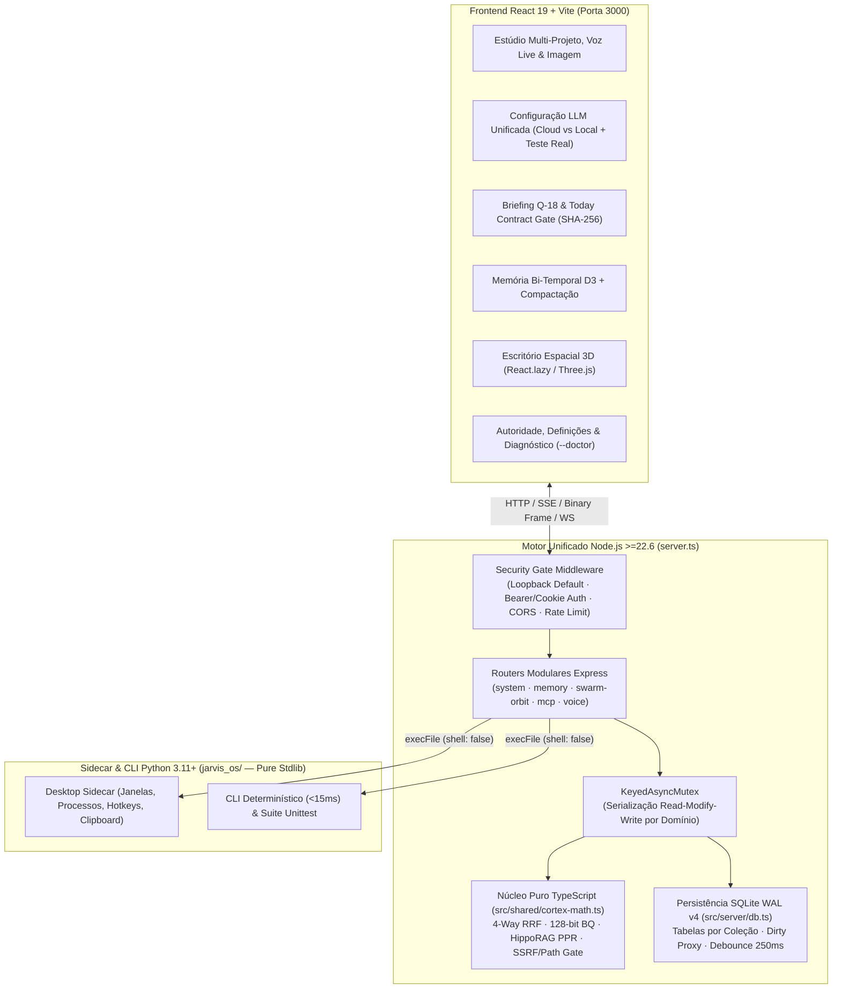

# J.A.R.V.I.S. Cortex OS v4.0

<p align="center">
  <strong>Estúdio Cognitivo Multi-Agente, Voz Bidirecional em Tempo Real, Memória Bi-Temporal HippoRAG &amp; Sidecar Local</strong><br>
  <em>Full-Stack Node.js &ge;22.6 + React 19 Studio HUD &bull; Python 3.11+ Zero-Dependency Sidecar &amp; CLI</em>
</p>

<p align="center">
  =22.6">
  
  
  
  
  
  
</p>

---

## Visão Geral da Arquitetura (Duas Camadas Complementares)

O **J.A.R.V.I.S. Cortex OS v4.0** separa de forma explícita o **produto web full-stack** do **agente Sidecar/CLI nativo**, eliminando duplicação de servidores e declarando com total transparência os requisitos de execução de cada camada:

| Camada | Runtime &amp; Dependências | Papel Arquitetural | Porta / Invocação |
|---|---|---|---|
| **1. J.A.R.V.I.S. Studio &amp; HUD (Motor Principal)** | **Node.js &ge; 22.6** (`node:sqlite` nativo), **Express 4**, **React 19**, **Tailwind CSS 4**, **D3**, **Three.js** *(lazy-loaded)*, **WebSocket (`ws`)**, **`@google/genai`** | Servidor unificado HTTP/SSE/WS (`server.ts`), routers modulares (`src/server/routes/*`), persistência SQLite WAL v4 por coleção com fila *debounced* (`250 ms`), Gate de Segurança (`JARVIS_API_TOKEN`), Memória 4-Way RRF, Enxame Swarm 48x, Ponte de Voz Gemini Live/TTS, Estúdio de Imagem e Gateway MCP. | `http://127.0.0.1:3000` (`npm run dev` / `npm start`) |
| **2. Sidecar Desktop &amp; CLI Determinístico (`jarvis_os/`)** | **Python 3.11+** (**0 dependências `pip`** — 100% biblioteca padrão) | Arranque `<15 ms` e `0 GB VRAM`. Invocado pelo servidor Node via `execFile(..., { shell: false })` para telemetria Kernel32/POSIX, enumeração de janelas ativas, hotkeys globais, captura de ecrã nativa, DSP acústico WAV Mark-VII e suite de verificação `unittest`. | `python3 -m jarvis_os.cli ...` |

> **Zero-LLM / Zero-Ollama Obrigatório no Núcleo Determinístico:** Todos os motores cognitivos determinísticos (planeador Q-18 Next-Action, pesquisa híbrida 4-Way RRF, 128-bit Binary Quantization POPCNT, HippoRAG 2 Personalized PageRank, roteador JEV-S1, extração automática de entidades e compactação de memória) correm **100% localmente sem exigir GPU nem chaves externas**. Para conversação generativa, voz neural e criação/edição de imagens, o painel **Configuração LLM** suporta **Gemini API**, **OpenRouter** ou **motores locais OpenAI-compatíveis** (`LM Studio :1234`, `vLLM :8000`, `Ollama :11434`).

---

## Funcionalidades Principais

- **Estúdio Multi-Projeto &amp; Ideia-para-Código**: Espaços de trabalho isolados com threads de chat por projeto, árvore de ficheiros, símbolos AST, estado Git, artefactos estruturados e inspeção de impacto (*Blast Radius*).
- **Painel Unificado de Configuração LLM &amp; ROI (`Configuração LLM`)**: Suporte integrado para chaves Cloud (**Gemini** / **OpenRouter**) e modos 100% locais (**LM Studio**, **vLLM**, **Ollama**), com análise transparente de custo/benefício mensal (*Token Diet*) e **teste de conectividade em tempo real**.
- **Voz Bidirecional em Tempo Real &amp; Seletor de Vozes**:
  - Ponte WebSocket **Gemini Live** (`16 kHz PCM` entrada / `24 kHz` saída) com interrupção natural (*barge-in*) e sincronização opcional de frames do ecrã.
  - Catálogo de vozes selecionáveis (`Kore`, `Puck`, `Charon`, `Fenrir`, `Aoede`, `Orbit`, entre outras) com pré-escuta instantânea (`gemini-3.8-flash-lite-tts`), transcrição neural (`gemini-3.5-transcribe`) e filtro acústico **Mark-VII Helmet HUD**.
- **Criação &amp; Edição Multimodal de Imagens**: Geração de ativos visuais e edição assistida sobre imagens/capturas existentes diretamente no Estúdio, com envio binário otimizado (`POST /api/screen/analyze-binary`, sem inflação `+33%` de JSON base64).
- **Memória Bi-Temporal HippoRAG 2 &amp; Compactação Automática**:
  - Pesquisa híbrida **4-Way Weighted RRF** combinando BM25 léxico, **128-bit Binary Quantization (POPCNT)**, **HippoRAG Personalized PageRank (PPR)** e curva de retenção de **Ebbinghaus** (`WORKING`, `EPISODIC`, `SEMANTIC`).
  - **Extração automática de entidades e arestas** na ingestão (`extractEntitiesAndInferEdges`) e **compactação do cofre** (`compactMemoryVault`: fusão de quase-duplicados `>= 0.92`, expiração TTL de memória de trabalho e poda de ruído).
- **Enxame 48x &amp; Escritório Espacial 3D (`React.lazy`)**: Coordenação paralela em 4 faixas (`FRONTEND`, `BACKEND`, `TESTS`, `INFRA`) com visualização espacial Three.js carregada sob demanda (*code-splitting*), poupando centenas de KB no bundle inicial.
- **Governação, Contratos Hoje (SHA-256) &amp; Diagnóstico `--doctor`**:
  - **Today Contract Gate**: fecho de tarefas condicionado a prova empírica (`FILE_EXISTS` com SHA-256 real no disco, `HTTP_CHECK` protegido contra SSRF ou `COMMAND_EXIT_0`).
  - **Painel &amp; CLI `--doctor`**: auditoria instantânea de versão Node, tabelas SQLite WAL v4, política de autenticação/rede, estado dos providers LLM, Sidecar Python e espaço em disco.

---

## Diagrama de Arquitetura v4.0



---

## Início Rápido (Quickstart)

### Pré-requisitos
- **Node.js `>= 22.6.0`** (inclui `node:sqlite` e execução nativa de TypeScript em `node server.ts`)
- **Python `>= 3.11`** (recomendado para o Sidecar Desktop e suite `unittest`; **zero pacotes `pip`**)

### Caminho A — Aplicação Completa J.A.R.V.I.S. Studio &amp; HUD (Recomendado)

```bash
git clone https://github.com/Miguel-Reis/jarvis-cortex-os.git
cd jarvis-cortex-os

# 1. Instalar dependências do Studio Web
npm install

# 2. Configurar variáveis de ambiente (opcional: GEMINI_API_KEY, JARVIS_API_TOKEN, SEED_MODE)
cp .env.example .env

# 3. Executar diagnóstico completo do ambiente (--doctor)
npm run doctor

# 4. Arrancar em modo desenvolvimento (http://127.0.0.1:3000)
npm run dev
```

Para compilar e executar em **produção**:

```bash
npm run build
NODE_ENV=production npm start
```

### Caminho B — CLI &amp; Sidecar Python Puro (`jarvis_os/`, Zero Dependências)

```bash
# Telemetria física (RAM, NVMe/Disco e Radar de Portas TCP)
python3 -m jarvis_os.cli status

# Planeador determinístico Q-18 & Today Contract Gate
python3 -m jarvis_os.cli plan

# Briefing executivo em Português Europeu (+ síntese WAV Mark-VII opcional)
python3 -m jarvis_os.cli briefing --lang pt

# Inspeção de janelas ativas, processos e hotkeys do Sidecar
python3 -m jarvis_os.cli sidecar
```

> Os launchers auxiliares (`python3 jarvis_app.py --open`, `python3 app.py` e `JarvisHUD.bat` no Windows) delegam automaticamente para o servidor unificado `server.ts` na porta `3000`, evitando qualquer duplicação de estado ou backend.

---

## Variáveis de Ambiente (`.env`)

| Variável | Predefinição | Descrição |
|---|---|---|
| `PORT` | `3000` | Porta HTTP/SSE/WebSocket do servidor unificado. |
| `HOST` | `127.0.0.1` | Interface de escuta. `0.0.0.0` exige opt-in explícito **e** `JARVIS_API_TOKEN` definido em redes locais. |
| `JARVIS_API_TOKEN` | *(vazio em loopback)* | Token secreto do operador (`Authorization: Bearer <token>` ou login por cookie `HttpOnly`). **Obrigatório** fora de loopback. |
| `JARVIS_CORS_ORIGIN` | *(mesma origem)* | Origem única autorizada para pedidos CORS cross-origin. |
| `SEED_MODE` | `demo` | `demo` carrega dados exemplificativos identificados como `SEED`; `real` inicia com histórico e enxames limpos. |
| `JARVIS_TRUST_THRESHOLD` | `70` | Limiar `[20..100]` do detetor de *Prompt Injection* e risco de comandos no Trust Boundary. |
| `JARVIS_FREEZE_STATE` | `0` | Quando `1`, aplica `Object.freeze` profundo em `db.getState()` para apanhar mutações fora de `db.update()`. |
| `JARVIS_DEBUG` | `1` (dev) / `0` (prod) | Ativa logs estruturados com redação automática de segredos e rotação diária (7 dias) em `logs/`. |
| `GEMINI_API_KEY` | *(opcional)* | Chave Google Gemini para Chat, Voz Live/TTS, Transcrição e Criação/Edição de Imagens. |
| `OPENROUTER_API_KEY` | *(opcional)* | Chave OpenRouter / endpoint OpenAI-compatível alternativo. |

---

## Segurança, Persistência &amp; Governação (v4.0)

| Domínio | Garantias Arquiteturais |
|---|---|
| **Bind Seguro &amp; Autenticação (`A-01`)** | Escuta por omissão em `127.0.0.1`. Expor `HOST=0.0.0.0` numa LAN sem `JARVIS_API_TOKEN` é recusado no arranque. Validação `Bearer` em tempo constante (`crypto.timingSafeEqual`) + cookie assinado HMAC `HttpOnly; SameSite=Strict`. |
| **CORS, CSRF &amp; Rate Limiting (`A-01`)** | Allowlist de origem única, bloqueio de mutações `Sec-Fetch-Site: cross-site` (`403`) e limitador *sliding-window* por IP em rotas sensíveis (`/api/workspace/exec`, `/api/sidecar/host-exec`, `/api/backup/*`, `/api/auth/login`). |
| **Motor Único sem Duplicação (`A-02`)** | `server.ts` é a única fonte de verdade da API e do estado; `app.py`, `jarvis_app.py` e `server.mjs` funcionam exclusivamente como launchers leves para `server.ts`. |
| **Persistência SQLite WAL v4 &amp; Mutex (`A-03`, `A-07`, `A-10`)** | Tabela `jarvis_collections_v4` com *prepared statements* transacionais (`BEGIN IMMEDIATE ... COMMIT`), rastreio `Proxy` apenas das coleções modificadas, fila *debounced* de `250 ms` com `flushSync()` no encerramento, migração estritamente versionada (`schemaVersion: 4`), importação `replaceAll` fiel sem injeção lateral e `KeyedAsyncMutex` em fluxos *read-modify-write*. |
| **Execução Estruturada &amp; Trust Boundary (`A-04`)** | Comandos simples executam via `execFile(..., { shell: false })` sem interpolação de shell. Operadores compostos (`;`, `|`, `&&`, `$()`, `` ` ``, redirecionamentos) exigem sempre aprovação humana explícita na **Inbox de Autoridade**, mesmo em modo `FULL_EXECUTIVE`. |
| **Path Boundary &amp; Anti-SSRF (`A-05`, `A-08`)** | `isPathInsideWorkspace` valida caminhos com `path.relative` (bloqueando fugas por prefixo irmão como `/app-evil`). `validateSafeOutboundUrl` com `redirect: 'error'` protege `HTTP_CHECK` e sondas MCP contra `169.254.169.254`, `0.0.0.0` e redes privadas RFC1918 não autorizadas. |
| **Honestidade de Dados (`A-06`)** | Métricas `quota5h` iniciam a `0`, contratos `FILE_EXISTS` calculam SHA-256 real no disco, contratos `HTTP_CHECK` iniciam `PENDING` até verificação empírica, e registos demonstrativos são etiquetados como `Demo` (`SEED`) com botão **Limpar Dados Demo** na UI. |
| **Logs Redigidos &amp; Transporte Binário (`A-11`, `A-14`)** | `sanitizeLogText` redige chaves `AIza*`, `sk-*`, `ghp_*`, cabeçalhos `Bearer` e `JARVIS_API_TOKEN` antes de gravar em disco, com retenção automática de 7 dias. Capturas de ecrã suportam upload binário direto (`express.raw`). |

---

## Mapa do Repositório

```text
├── server.ts                          # Entrypoint HTTP/SSE/WS unificado (Node.js >=22.6)
├── src/
│   ├── shared/
│   │   ├── types.ts                   # Contratos TypeScript partilhados (schemaVersion 4)
│   │   ├── cortex-math.ts             # 4-Way RRF, BQ 128-bit, PPR, Entity Linker, Compactor & Security Gates
│   │   └── cortex-math.test.ts        # Suite unitária determinística da matemática e segurança (32 testes)
│   ├── server/
│   │   ├── db.ts                      # SQLite WAL v4 por coleção + fila debounced 250ms + seeds honestos
│   │   ├── security-gate.ts           # Auth Bearer/Cookie, CORS single-origin, CSRF & Rate Limiter
│   │   ├── async-mutex.ts             # KeyedAsyncMutex para serialização read-modify-write
│   │   ├── doctor.ts                  # Diagnóstico completo CLI (--doctor) & API (/api/system/doctor)
│   │   ├── os-adapter.ts              # execFile sem shell, Path Boundary & Today Contract Gate
│   │   ├── voice-live-bridge.ts       # WebSocket Gemini Live bidirecional, catálogo de vozes & TTS/STT
│   │   ├── gemini-engine.ts           # Orquestrador LLM Cloud/Local, ferramentas MCP & visão/imagem
│   │   ├── debug-logger.ts            # Logger com redação AI-Defence e rotação diária (7 dias)
│   │   ├── routes/                    # Routers Express por domínio (system, memory, swarm-orbit, mcp)
│   │   └── architecture-audit.test.ts # Suite de integração v4 (SQLite WAL, Mutex, Security Gate, Doctor)
│   └── components/                    # Estúdio React 19, Configuração LLM, Grafo D3 & Enxame 3D (React.lazy)
├── jarvis_os/                         # Sidecar Desktop & CLI Python 3.11+ (Zero Dependências)
├── tests/                             # Suite Python unittest (15 testes) + testes ESM Node
└── .github/workflows/ci.yml           # Pipeline CI multi-SO (Ubuntu + Windows)
```

---

## Scripts, Testes &amp; CI

| Comando | Descrição |
|---|---|
| `npm run dev` | Inicia o servidor unificado + Vite em modo desenvolvimento (`tsx server.ts`). |
| `npm run build` | Gera o bundle otimizado de produção em `dist/` (com *code-splitting* 3D). |
| `npm start` | Executa o servidor nativamente em Node.js &ge;22.6 (`node server.ts`). |
| `npm run doctor` | Executa o diagnóstico completo de runtime, SQLite WAL v4, segurança e Sidecar. |
| `npm test` | Corre toda a suite unificada: TypeScript (`cortex-math` + `architecture-audit`), ESM Node e Python `unittest` (15 testes). |
| `npm run lint` | Verifica rigorosamente todos os tipos TypeScript (`tsc --noEmit`). |

---

## Licença

Distribuído sob a licença **MIT**. Consulte `LICENSE` para mais detalhes.

Desenvolvido por **Miguel Reis**.
